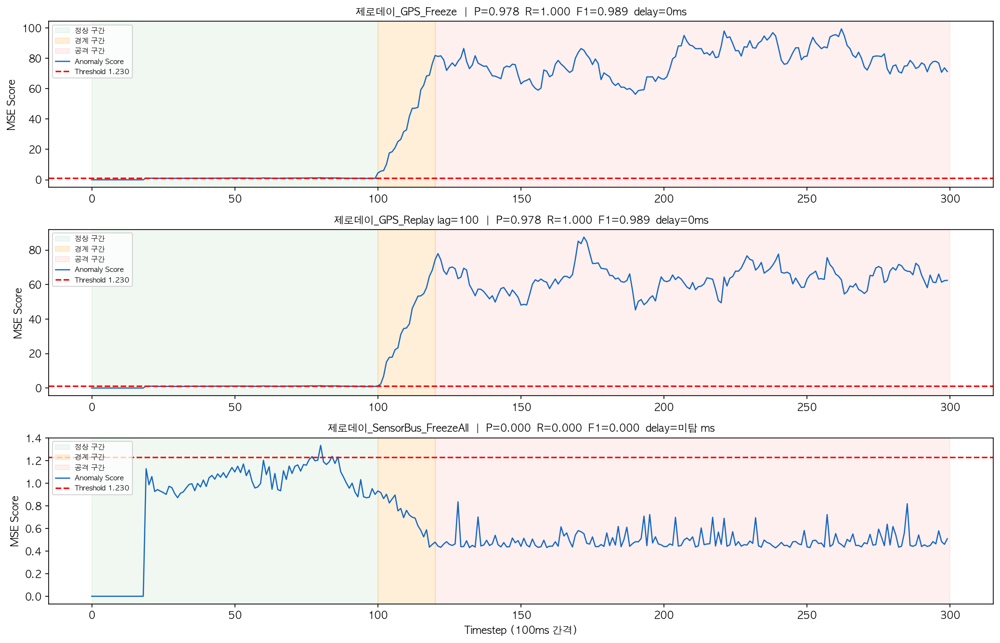
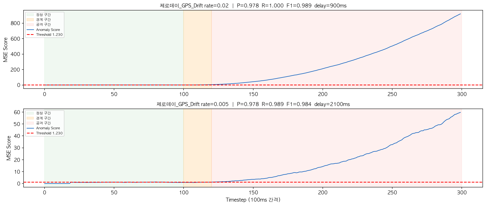

# 제로데이 공격 탐지 — 상세

> 이 문서는 `zeroday_attacks.py` 의 실험을 [실험결과_상세](실험결과_상세.md) 와 같은 형식으로 정리한 것입니다. 모든 수치는 `zeroday_results.json` 에서 그대로 가져왔습니다(재실행: `python3 zeroday_attacks.py`, 테스트: `python3 -m pytest tests/test_zeroday_attacks.py`).

## 1) "제로데이"의 정의와 선정 근거

예선과 `advanced_attacks.py` 의 9개 시나리오(기본 3종 · 복합 2종 · 점진적 4종)는 **전부 "정상값 + 덧셈 편향"** 입니다. 급격 공격은 편향 12(GPS)·25(고도)를 한 번에 더하고, 점진적 공격도 상한 12·25 까지 올라가는 램프라서 "결국 큰 공격"이 됩니다. 모델이 한 번도 본 적 없는 패턴을 고르기 위해, 여기서는 **값을 더하지 않고 센서 스트림의 시간 구조를 바꾸는** 공격 4종을 정의했습니다.

| 공격 | 무엇을 하는가 (`zeroday_attacks.py`) | 예선 공격과 다른 점 | 현실 대응 |
|---|---|---|---|
| **GPS Freeze** | t ≥ 100 에서 `gps_vel_x/y` 를 t = 99 값에 고정 | 값은 정상 범위 안. 편향 0. | GPS jamming 후 수신기가 마지막 유효 해(solution)를 반복 출력 |
| **GPS Replay (lag=100)** | t ≥ 100 에서 `gps_vel_x/y` 를 t−100 시점의 **원본 정상값**으로 치환 | 모든 값이 실제 정상 샘플 → 단일 피처 분포는 정상과 동일 | 녹음한 GPS 스트림을 지연 재생하는 기록-재생 스푸핑 |
| **GPS Drift (rate 0.02 / 0.005)** | `gps_vel_x += rate·(t−100)`, y 는 0.5배, **상한 없음** | 예선 점진 공격은 rate 0.1~0.3 · 상한 12. 드리프트는 5~60배 느리고, 200스텝 뒤에도 편향이 3.98 / 0.995 (정상 GPS σ ≈ 0.59 의 6.7σ / 1.7σ)에 그침 | meaconing 류 "천천히 끌고 가기" |
| **Sensor-bus Freeze (보너스)** | t ≥ 100 에서 **8개 피처 전부** t = 99 행에 고정 | 잔차 정합성(`residual = gps − imu`)까지 그대로 유지되는 유일한 시나리오 | 센서 버스/퍼블리셔 사망 — 마지막 메시지가 계속 전달 |

세 가지 GPS 공격은 모두 `_recalc_residual` 로 잔차(`residual_x/y = gps − imu`)를 다시 계산합니다. 이는 실제 시스템에서 잔차가 GPS 와 IMU 로부터 파생되는 양이기 때문이며, 뒤에서 보듯 **탐지 여부를 가르는 핵심 변수**입니다.

## 2) 실험 설정 — advanced_attacks.py 와 동일 경로

- 모델: `vae_uav.pth` (수정 없음), 윈도우 20, 입력 8 피처 × 20 = 160 차원
- 보정: `gen_normal(1000, seed=42)` → 피처별 mean/std 정규화 → 정상 윈도우 점수의 **95th percentile = 1.2301** 을 임계값으로 사용
- 테스트: `gen_normal(300, seed=123)`, 공격 시작 t = 100, 총 300 스텝(100 ms 간격). 공격 시작 후 19개 경계 윈도우는 평가에서 제외(TP+FN = 181, TN+FP = 100)
- 난수: VAE 가 추론 시에도 재파라미터화 샘플링을 쓰므로 `torch.manual_seed(42)` 로 고정. `advanced_attack_results.json` 의 임계값 1.2283 과 0.15 % 차이가 나는 이유이며([실험결과_상세](실험결과_상세.md) 2) 의 주석과 같은 사정), 판정에는 영향이 없습니다.
- 정상 보정셋 점수 분포(JSON `normal_score_stats`): min 0.7566 · p1 0.7995 · p5 0.8487 · mean 1.0242 · p95 1.2301 · max 1.505

## 3) 결과

| 공격 유형 | TP | FP | FN | Precision | Recall | F1 | 탐지 지연 | 최초 탐지 윈도우 top feature (기여 비율, 정상 대비 z) |
|---|---|---|---|---|---|---|---|---|
| GPS Freeze | 181 | 4 | 0 | 0.978 | 1.000 | 0.989 | 0 ms | `residual_x` (81 %, z = 98.9) |
| GPS Replay (lag=100) | 181 | 4 | 0 | 0.978 | 1.000 | 0.989 | 0 ms | `residual_y` (28 %, z = 5.1) |
| GPS Drift (rate=0.02) | 181 | 4 | 0 | 0.978 | 1.000 | 0.989 | 900 ms | `residual_x` (36 %, z = 9.8) |
| GPS Drift (rate=0.005) | 179 | 4 | 2 | 0.978 | 0.989 | 0.984 | 2,100 ms | `residual_x` (26 %, z = 5.7) |
| **Sensor-bus Freeze** | **0** | 4 | **181** | 0.000 | 0.000 | 0.000 | **미탐** | — (탐지 윈도우 없음) |

공격 구간(t ≥ 119) 이상 점수 요약:

| 공격 유형 | 점수 평균 | 점수 최대 | 점수 최소 | 정상 최솟값(0.7566) 미만 비율 |
|---|---|---|---|---|
| GPS Freeze | 77.978 | 99.472 | 56.327 | 0 % |
| GPS Replay (lag=100) | 63.504 | 87.541 | 45.299 | 0 % |
| GPS Drift (rate=0.02) | 323.635 | 920.469 | 4.158 | 0 % |
| GPS Drift (rate=0.005) | 21.369 | 59.721 | 1.139 | 0 % |
| Sensor-bus Freeze | 0.492 | 0.837 | 0.429 | **98.9 %** |

FP 4건은 5개 시나리오 모두 동일한 정상 구간 윈도우(t = 77, 80, 84, 86)에서 나왔습니다. 공격 전 구간은 시나리오 간에 같은 데이터이므로 당연한 결과이며, 예선 결과표의 FP 3~8건과 같은 수준입니다.

**절제 실험 — 잔차를 재계산하지 않으면?** (JSON `ablation_no_residual`)

| 시나리오 | TP | FN | Recall | 탐지 지연 | 공격 구간 점수 평균 / 최대 |
|---|---|---|---|---|---|
| Freeze, 잔차를 공격 전 원본으로 고정 | 0 | 181 | 0.000 | 미탐 | 1.033 / 1.215 |
| Replay, 잔차를 공격 전 원본으로 고정 | 0 | 181 | 0.000 | 미탐 | 1.031 / 1.214 |

| Freeze · Replay · Sensor-bus Freeze | Drift 0.02 · 0.005 |
|---|---|
|  |  |

## 4) 공격별 해석

### GPS Freeze / Replay — 탐지됐지만, 그 이유는 GPS 패턴이 아니라 잔차다

두 공격 모두 지연 0 ms, Recall 1.000 으로 잡혔습니다. 그러나 이것을 "모델이 동결·재생 패턴을 학습했다"고 읽으면 틀립니다.

- `gen_normal` 은 **스텝 간 시간 구조가 없는** 생성기입니다(매 스텝 독립 균일 난수). 따라서 "같은 값이 200번 반복된다"거나 "100스텝 전 값이 되돌아온다"는 사실은 이 데이터·이 모델에서는 정의상 이상이 아닙니다. 윈도우 안의 각 샘플이 정상 분포 안에 있으면 VAE 는 그 윈도우를 정상으로 재구성합니다.
- 실제로 탐지를 만든 것은 `residual = gps − imu` 입니다. 정상에서 잔차는 IMU 노이즈만 남아 σ ≈ 0.05 인데, GPS 가 고정/재생되면 잔차가 `gps(고정값) − imu(t)` 로 바뀌어 크기 O(1) 의 값이 됩니다(정상 잔차 σ 의 수십 배). 최초 탐지 윈도우의 피처 기여도가 Freeze 에서 `residual_x` 81 % (z = 98.9), Replay 에서 `residual_y` 28 % (z = 5.1)인 것이 그 증거입니다.
- 절제 실험이 이를 확정합니다. 잔차를 공격 전 원본으로 되돌리면 — 즉 GPS-IMU 교차검증이 없는 시스템이라면 — **Freeze 와 Replay 모두 181개 윈도우 전부 미탐**이고, 공격 구간 점수 평균(1.033 / 1.031)이 정상 보정셋 평균(1.0242)과 사실상 같습니다. GPS 열만 보면 이 모델은 동결과 재생을 전혀 구분하지 못합니다.

즉 이 두 결과의 올바른 해석은 "VAE 가 제로데이를 잡았다"가 아니라 **"IMU 와의 잔차 피처를 입력에 넣어 둔 설계 덕분에, GPS 만 조작하는 공격은 패턴이 무엇이든 잡힌다"** 입니다. 이는 예선의 임계값 민감도 분석(GPS 계열이 0.1σ 에서도 AUC 0.98 인 이유)과 같은 메커니즘입니다. 거꾸로, 공격자가 GPS 와 IMU 를 **함께** 일관되게 조작하면 이 방어는 사라집니다 — Sensor-bus Freeze 가 바로 그 경우입니다.

### GPS Drift — 탐지 지연은 rate 에 반비례하고, 탐지 기준은 "잔차가 약 2σ 를 넘는 시점"이다

- rate 0.02: 지연 9 스텝(900 ms). 최초 탐지 시점(t = 109) 편향 = 0.02 × 9 = 0.18.
- rate 0.005: 지연 21 스텝(2,100 ms). 최초 탐지 시점(t = 121) 편향 = 0.005 × 21 = 0.105. 경계 구간 직후 두 윈도우(t = 119, 120)가 임계값 바로 아래(공격 구간 점수 최소 1.139 < 1.2301)여서 **FN 2건**, Recall 0.989.

두 경우 모두 편향이 **정상 잔차 σ(≈ 0.05)의 약 2~4배**에 이르는 순간 임계값을 넘었고, 그 뒤로는 편향이 상한 없이 커지므로 점수가 단조 증가(최대 920.469 / 59.721)합니다. 예선 점진 공격(rate 0.1 → 400 ms, 0.3 → 200 ms)과 나란히 놓으면 **rate 가 4배 느려질 때 지연이 약 2.3배(900 → 2,100 ms)** 늘어나는 관계입니다. 탐지 지연은 결국 "편향이 잔차 노이즈 몇 σ 에 도달하는 데 걸리는 시간"이고, 드리프트가 느릴수록 그 시간은 선형으로 늘어납니다. rate 0.001 처럼 더 느린 드리프트라면 5초 이상 걸리며, 그 사이 기체는 이미 편향된 위치로 이동하고 있다는 뜻입니다. 여기서도 탐지 피처는 `residual_x` (36 % / 26 %)이지 `gps_vel_x` 가 아닙니다.

### Sensor-bus Freeze — 완전 미탐, 그리고 그 이유는 점수가 "너무 낮아서"다

8개 피처 전부 동결하면 **181개 윈도우 전부 미탐(Recall 0.000)** 입니다. 이것이 이 실험의 가장 중요한 발견입니다.

- 동결된 행은 정상 샘플 하나이고, 잔차 정합성도 그대로이므로 각 피처 값은 모두 정상 분포 안에 있습니다. 게다가 20개 행이 완전히 같은 윈도우는 VAE 입장에서 **가장 재구성하기 쉬운 입력**입니다. 공격 구간 점수 평균 0.492, 최대 0.837 로, 정상 보정셋 **최솟값 0.7566 보다도 낮은 윈도우가 98.9 %** 입니다. 그림에서 공격 시작 직후 점수가 정상 수준(≈1.0)에서 0.5 로 **떨어지는** 것이 그것입니다.
- 현재 판정 규칙은 `score > threshold` 한 방향뿐입니다. 상한만 보는 탐지기는 "분포 밖으로 나가는" 이상만 잡고, "분포 안에서 지나치게 규칙적인" 이상은 구조적으로 보지 못합니다.
- 뒤집어 말하면 이 미탐은 모델 용량의 문제가 아니라 판정 규칙의 문제입니다. 점수가 정상 최솟값 아래로 떨어진 비율이 98.9 % 라는 사실은, **하한 임계값(예: 정상 p1 = 0.7995 미만이면 경보)** 또는 **윈도우 내 분산 0 검사(stale-data check)** 같은 단순 규칙만 더해도 거의 전부 잡힌다는 뜻입니다. 다만 이 문서에서는 그 규칙을 구현·평가하지 않았으므로, "잡힐 것"은 수치로 확인된 결론이 아니라 다음 단계의 가설입니다.

## 5) 정직한 요약

- **잡힌 것**: GPS 단독 조작 4종(Freeze · Replay · Drift ×2)은 모두 Recall ≥ 0.989 로 탐지. 단, 네 경우 모두 최초 탐지 피처가 `residual_x/y` 이고, 잔차를 되돌린 절제 실험에서 Freeze/Replay 가 완전 미탐이 된 것으로 보아 **탐지의 근거는 GPS 패턴이 아니라 GPS-IMU 잔차**입니다. `gen_normal` 에 시간 구조가 없으므로, 이 결과를 "시간 패턴 기반 제로데이 탐지 능력"으로 주장하면 안 됩니다.
- **늦게 잡힌 것**: Drift 는 rate 에 비례해 지연이 늘어납니다(0.02 → 900 ms, 0.005 → 2,100 ms, FN 2). 더 느린 드리프트는 더 늦게 잡히며, 하한은 잔차 노이즈 σ 로 정해집니다.
- **못 잡은 것**: Sensor-bus Freeze 는 181/181 미탐. 단방향 임계값이 "너무 정상적인" 입력을 구조적으로 놓치는 사례이며, 점수의 98.9 % 가 정상 최솟값 아래라는 점에서 하한 임계값·분산 검사가 다음 개선 과제입니다.
- **일반화 한계**: 테스트 정상 데이터가 합성(균일 난수)이라 FP 4건·임계값 1.2301 등 절대 수치는 실제 비행 로그에서 달라집니다. 상대적 결론(잔차 의존성, rate-지연 관계, 하한 미탐)은 데이터 생성기와 무관하게 성립하는 구조적 성질입니다.

관련 파일: [`zeroday_attacks.py`](../zeroday_attacks.py) · [`zeroday_results.json`](../zeroday_results.json) · [`tests/test_zeroday_attacks.py`](../tests/test_zeroday_attacks.py)
